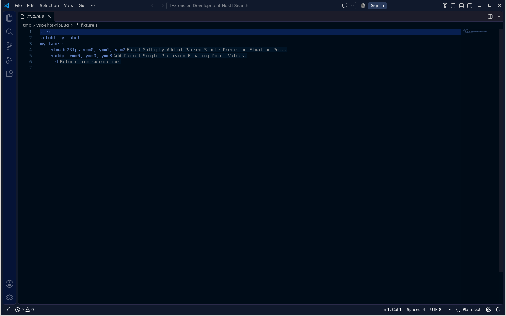
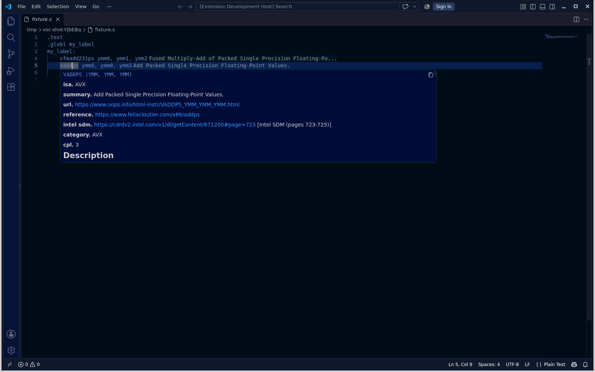
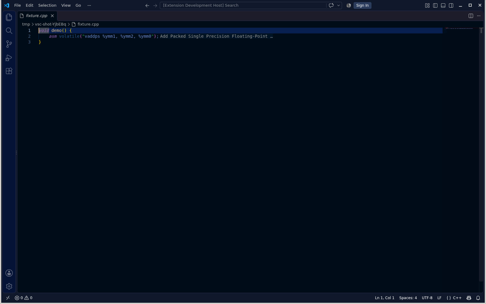
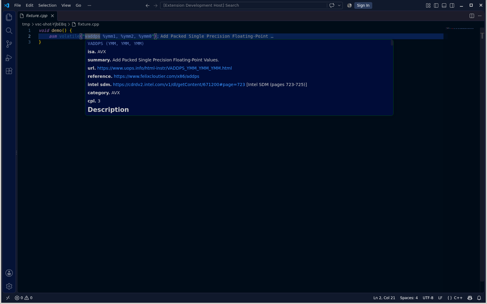

# vscode-simdref






The extension connects VS Code to `simdref-lsp`, the language server of [simdref](https://github.com/simd-labs/simdref).
In `.s`, `.S`, `.asm` and `.ptx` files and `asm(...)` strings in C/C++, it shows a one-line brief of each instruction inline.
In CUDA files (`.cu`, `.cuh`), it shows the same brief.
VS Code has no NASM language, so `.nasm` files get no hints.

Hover shows the full simdref page for an instruction from the local catalog.

The extension installs the newest simdref from PyPI.
VS Code cuts hints at 43 characters (`editor.inlayHints.maximumLength`).
The extension makes the limit `0` for the assembly and CUDA language ids.
Set it to `0` for C/C++ and files without an assembly extension.
The extension has no settings.
The extension runs with cpptools or clangd for C, C++ and CUDA files.

## Automatic install

At start, the extension looks for `simdref-lsp` on `PATH`, then in the extension storage.
An old `simdref-lsp` on `PATH` has no inlay hints. Remove it.
If not found, the extension downloads `uv` into its storage, runs `uv tool install simdref` and `isa update`.
The extension checks the uv download against the release checksum.
All writes stay in the extension storage.
The extension upgrades simdref in the background every day. A new simdref version takes effect at the next server start.
Reload the window to start a new server.

## Install

```
git clone https://github.com/simd-labs/vscode-simdref
cd vscode-simdref
npm install
npm run compile
npx @vscode/vsce package
code --install-extension vscode-simdref-*.vsix
```

The server install is optional. The extension installs `simdref` on start when `simdref-lsp` is missing.
To install the server on `PATH`, run:

```
uv tool install simdref
isa update
```

After the install, start VS Code again. The server opens the catalog only at start.
`pip install simdref` also works.

## License

GPL-3.0-or-later.
